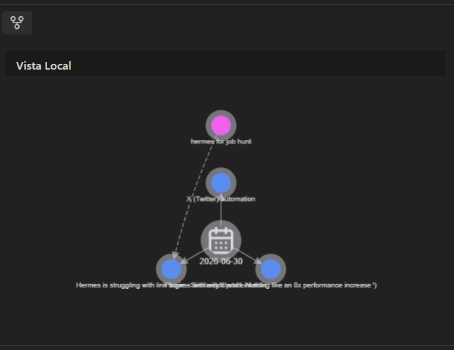

# Better Local Graph


[](assets/0805.mp4)

**Better Local Graph** is an Obsidian plugin that transforms the local graph into a **live project context for you and your AI agents**. It goes beyond visualization: it lets you define meaningful parent-child relationships between notes through a visual **Sewing** session, bookmark nodes for quick access, and cross-reference tags from the tag panel. The embedded **MCP server** exposes your note graph to external AI agents (Claude Code, OpenCode, Gemini, etc.), giving them precise context about what you're working on — **your agent will never search your entire vault again, saving tokens and providing direct context on what you're currently viewing**.

No more generic graphs. Your agent knows your current project structure because you built it, note by note, through the `sewing` property.

## Features

**Local Graph** — See the connections of your active note at a glance. Nodes show Lucide icons, edges have direction arrows, and colors reflect how recently notes were modified (subtle pulse animation for fresh content). Right-click any node to bookmark it and access it later from any note via the **Coser A** command.

**Sewing (`sewing` property)** — The core relationship system. Create **parent-child** links between notes through a visual session or the command palette:

> **Example**: You're working on a project called "Apolo". You sew `Apolo` as parent and add `Diseño`, `Backend`, `API Docs` as children. The plugin writes `sewing: [Diseño, Backend, API Docs]` in `Apolo`'s frontmatter and assigns each child a tag like `apolo/sewing/diseno`. Now your AI agent, querying via MCP, instantly knows the scope of "Apolo" — it doesn't need to scan the whole vault.

> **Cross-tag relationships**: From the tag panel, you can select nodes from different tag branches and sew them together, creating relationships that cut across your classification system — a note tagged `ia/agentes` can be parent to one tagged `backend/api`, bridging silos.

**Bookmarks** — Right-click any node in the graph to **bookmark** it (adds it to the bookmark selection panel). Then, from any other note, run the command **"Coser A"** (Sew To) to quickly relate the active note to your bookmarked nodes — seamless, no hunting.

**Tag Overview** — Switch to tag mode and filter the whole vault by a tag or subtag. The fcose layout arranges nodes in a clustered, readable graph. Age-based coloring and pulse make old vs new content instantly visible. Select nodes and sew them across tags for cross-domain relationships.

**Tag mindmap** — Run the **Tag mindmap** command to open a markmap of any tag and its subtags in a modal. Branches fold, clicking a node opens the note at the exact tag line, and right-clicking a branch renames that tag across every note under it.

**Animated backgrounds** — Programmable canvas backgrounds: the plugin loads small JS snippets from the `backgrounds/` folder inside its own directory, with a picker and live preview in settings.

**AI Tooltips** — Hover over any node to see an AI-generated summary of that note. Bring Your Own Key (BYOK) — works with any OpenAI-compatible provider.

**MCP Server** — Embedded Streamable HTTP server on `localhost` so external AI agents can query and manipulate your graph in real time.

> **MCP usage example**: Your coding agent needs to know the context of your current feature. It calls `sewingTargets("Apolo.md")` via MCP and immediately gets `["Diseño", "Backend", "API Docs"]` — the exact scope. It can then call `getTagGraph("apolo")` to explore the full subtree, or `sew("Diseño.md", ["Mockups.md"])` to add a new child programmatically. Your agent works *with your structure*, not against it.

**Bilingual** — Full English & Spanish interface.

## Requirements

- Obsidian v1.4.11+
- Desktop only (uses canvas/graph rendering)
- Optional: OpenAI-compatible API key for AI tooltips

## Installation

### From GitHub Release

1. Go to [Releases](https://github.com/kapela2017/Better-Local-Graph/releases) and open the release for the version you want.
2. Download these three files from the release assets: `main.js`, `manifest.json` and `styles.css`.
3. Create the folder `.obsidian/plugins/better-local-graph/` inside your vault and put the three files there.
4. Enable the plugin in **Settings → Community plugins**.

There is no zip: the release ships the three files separately, exactly as Obsidian expects them.

### From Source (development)

This repository distributes the assembled bundle, not a TypeScript project. See [Build](#build) for how `main.js` is produced from the sources.

```bash
git clone git@github.com:kapela2017/Better-Local-Graph.git
cd Better-Local-Graph
node scripts/build.mjs
```

## Configuration

Key settings in the plugin options tab:

| Setting | Description |
|---------|-------------|
| MCP Enabled | Enable the embedded MCP server for AI agent integration |
| MCP Port | Server port (default: 27125) |
| MCP Token | Bearer token for MCP authentication |
| AI Provider | OpenAI-compatible endpoint for AI tooltips |
| UI Language | English or Spanish |

## MCP Server

The plugin includes a built-in MCP server for AI agents.

**One click, done:** the plugin has a button in Settings called "MCP: copy agent prompt" (also available from the command palette Ctrl+P as "Copy agent MCP prompt"). Click it, it copies the full prompt with your URL, token and tools to your clipboard. Paste into ChatGPT, Claude or Gemini, and you are ready.

If you prefer direct config for your coding agent (Claude Code, OpenCode, Cursor):

```json
{
  "mcpServers": {
    "better-local-graph": {
      "url": "http://localhost:27125/mcp",
      "headers": {
        "Authorization": "Bearer <your-token>"
      }
    }
  }
}
```

Available tools: `blg_exit_tag_view`, `blg_get_active_note_relations`, `blg_get_current_base`, `blg_get_current_view`, `blg_get_note`, `blg_get_tag_graph`, `blg_list_tags`, `blg_open_tag_view`, `blg_pin_board`, `blg_search_content`, `blg_search_notes`, `blg_sew`, `blg_update_base_cards`.

## Network use and privacy

- **Local MCP server:** the server binds to `127.0.0.1` only, uses a configurable port and requires a Bearer token. It is not exposed to the network.
- **AI tooltips:** the note content is sent to the OpenAI-compatible endpoint configured by the user, using the user's own API key (BYOK).
- No telemetry, no background calls and no auto-update.

## Build

This repository distributes the runnable bundle. There is no TypeScript source or sourcemap for the minified core: `src/core.bundle.js` is that core, preserved byte for byte as a build artifact, and its original source is unavailable.

The build uses Node.js only, with no npm dependencies. It assembles `main.js` in this order:

1. `src/core.bundle.js`
2. `src/vendor-markmap.inline.js`
3. `blg-mcp-server.js`
4. `blg-backgrounds.js`
5. `blg-tag-mindmap.js`
6. `blg-pin-board.js`
7. `blg-folder-drops.js`

Module line endings are normalized in memory; source files are not rewritten. No separators are added except the explicit newline between the pin-board and folder-drops modules. The markmap vendor is embedded in `main.js`; the original `blg-vendor-markmap.js` remains in the repository for traceability.

```bash
# Assemble main.js
node scripts/build.mjs

# Validate the sources and compare without writing
node scripts/build.mjs --check
```

A release distributes only `main.js`, `manifest.json` and `styles.css`.

## License

MIT
